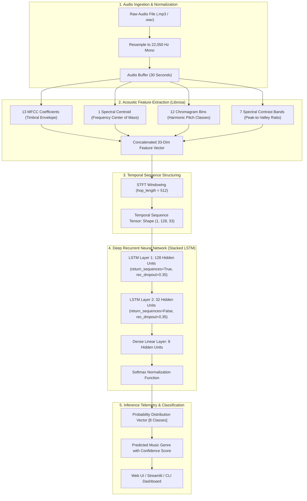
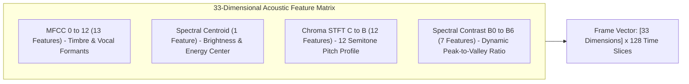
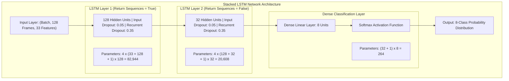
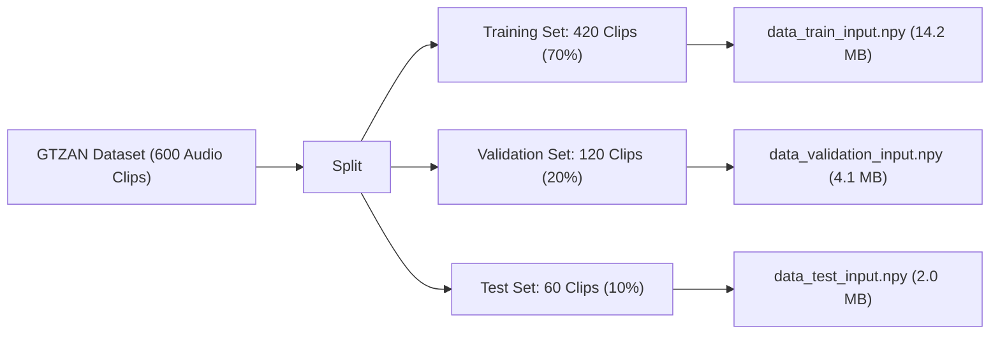
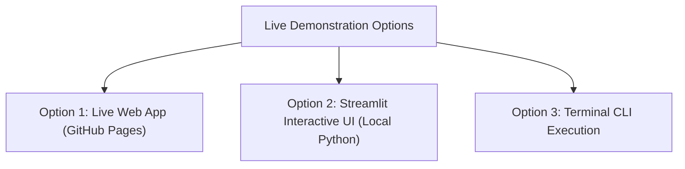

# Music Genre Classification Using LSTM-Based Deep Learning on Audio Features

[](https://ken-kanike.github.io/DL-Mini-Project/)
[](https://github.com/Ken-Kanike/DL-Mini-Project)
[](https://github.com/Ken-Kanike/DL-Mini-Project)
[](https://github.com/Ken-Kanike/DL-Mini-Project)

> 🌐 **Live Interactive Web Application:** [https://ken-kanike.github.io/DL-Mini-Project/](https://ken-kanike.github.io/DL-Mini-Project/)  
> Test preloaded GTZAN audio samples or upload custom tracks directly in your browser with real-time waveform visualization, execution telemetry, and LSTM genre classification.

---

## Deep Learning Mini Project — Group 25

### Project Information

| Domain | Application Name | DL Architectures Used | Project Topic |
| :--- | :--- | :--- | :--- |
| Audio Signal Processing, Music Information Retrieval (MIR) | Automated Music Genre Classification | Long Short-Term Memory (LSTM), Recurrent Neural Network (RNN) | Music Genre Classification Using LSTM-Based Deep Learning on Audio Features |

---

### Team Details

| Group No. | Batch | Roll No. | Name of Student |
| :---: | :---: | :---: | :--- |
| **25** | B23 | 125 | Arzoo Vaswani |
| **25** | B23 | 133 | Riya Maurya |
| **25** | B23 | 137 | Junaid Shaikh |

---

## Table of Contents
1. [Executive Summary & Problem Statement](#1-executive-summary--problem-statement)
2. [End-to-End System Architecture](#2-end-to-end-system-architecture)
3. [Audio Signal Processing & Feature Extraction](#3-audio-signal-processing--feature-extraction)
4. [Deep Learning Model Architecture](#4-deep-learning-model-architecture)
5. [Dataset Specifications & Preprocessing](#5-dataset-specifications--preprocessing)
6. [Training Methodology & Hyperparameters](#6-training-methodology--hyperparameters)
7. [Experimental Results & Evaluation](#7-experimental-results--evaluation)
8. [Live Demonstration & Execution Options](#8-live-demonstration--execution-options)
9. [Advantages & Limitations](#9-advantages--limitations)
10. [Academic References & Sources](#10-academic-references--sources)

---

## 1. Executive Summary & Problem Statement

### The Challenge
Categorizing music into genres manually is highly subjective, labor-intensive, and impractical given the millions of audio tracks uploaded daily to streaming platforms. Traditional machine learning techniques (such as SVMs or shallow MLPs with static summary statistics like global mean and variance) fail to capture the sequential, rhythmic, and harmonic temporal progressions that distinguish musical styles.

### The Solution
This project implements an end-to-end deep learning pipeline leveraging **stacked Long Short-Term Memory (LSTM) Recurrent Neural Networks**. By converting raw audio into a sequence of 128 temporal frames across 33 domain-specific acoustic and spectral dimensions, our model retains long-term sequential dependencies in musical structure, enabling accurate multi-class classification across 8 distinct musical genres.

---

## 2. End-to-End System Architecture

The following diagram illustrates the complete dataflow from raw audio ingestion to feature extraction, tensor formatting, neural inference, and interactive telemetry visualization:



---

## 3. Audio Signal Processing & Feature Extraction

Directly feeding high-frequency raw audio waveforms (e.g., 22,050 samples per second $\times$ 30 seconds = 661,500 data points) into an RNN is computationally intractable and prone to vanishing gradients. We extract **33 domain-specific acoustic features** per time frame:



### Detailed Mathematical Description:
1. **Mel-Frequency Cepstral Coefficients (MFCCs) [13 Dimensions]**:
   * Computed by taking the Discrete Cosine Transform (DCT) of the logarithmically scaled Mel-filterbank energies.
   * Accurately models the human ear's non-linear frequency perception, capturing timbral texture and formant resonance.
2. **Spectral Centroid [1 Dimension]**:
   * Evaluates the center of gravity of the power spectrum:
     $$\text{Centroid} = \frac{\sum_{k} f(k) \cdot S(k)}{\sum_{k} S(k)}$$
   * Directly correlates with perceived sound "brightness" (e.g., higher for Metal/Pop, lower for Classical/Jazz).
3. **Chromagram (STFT) [12 Dimensions]**:
   * Projects spectral energy onto the 12 semi-tone pitch classes ($C, C\sharp, D, D\sharp, E, F, F\sharp, G, G\sharp, A, A\sharp, B$).
   * Captures harmonic progressions, key signatures, and chord qualities independent of instrumentation octave.
4. **Spectral Contrast [7 Dimensions]**:
   * Measures the decibel difference between spectral peaks and spectral valleys across 7 sub-bands.
   * Differentiates clear harmonic instruments from noisy broadband percussive textures.

---

## 4. Deep Learning Model Architecture

The neural network is built with a stacked 2-layer Long Short-Term Memory (LSTM) network followed by a Dense softmax classification head:



### Parameter Calculation Breakdown:

$$\text{LSTM Parameters} = 4 \times \left[(\text{input\_dim} + \text{hidden\_dim} + 1) \times \text{hidden\_dim}\right]$$

| Layer | Type | Input Dimension | Output Dimension | Trainable Parameters | Activation |
| :--- | :--- | :---: | :---: | :---: | :---: |
| **LSTM 1** | Recurrent (LSTM) | `(128, 33)` | `(128, 128)` | **82,944** | $\tanh$ / Hard Sigmoid |
| **LSTM 2** | Recurrent (LSTM) | `(128, 128)` | `(32)` | **20,608** | $\tanh$ / Hard Sigmoid |
| **Dense** | Fully Connected | `(32)` | `(8)` | **264** | Softmax |
| **Total** | | | | **103,816** (~405 KB) | |

---

## 5. Dataset Specifications & Preprocessing



* **Dataset**: GTZAN Genre Collection (standard academic benchmark).
* **Target Classes (8 Genres)**: `Classical`, `Country`, `Disco`, `Hip-Hop`, `Jazz`, `Metal`, `Pop`, `Reggae`.
* **Audio Sampling**: 22,050 Hz, 16-bit mono, 30 seconds per clip.
* **Preprocessed Arrays**:
  * `data_train_input.npy`: Shape `(420, 128, 33)`
  * `data_train_target.npy`: Shape `(420, 8)`
  * `data_validation_input.npy`: Shape `(120, 128, 33)`
  * `data_validation_target.npy`: Shape `(120, 8)`
  * `data_test_input.npy`: Shape `(60, 128, 33)`
  * `data_test_target.npy`: Shape `(60, 8)`

---

## 6. Training Methodology & Hyperparameters

### Training Configuration
* **Optimization Algorithm**: Adam ($\text{learning rate} = 0.001, \beta_1 = 0.9, \beta_2 = 0.999, \epsilon = 10^{-8}$)
* **Loss Function**: Categorical Cross-Entropy:
  $$\mathcal{L} = -\sum_{i=1}^{C} y_i \log(\hat{y}_i)$$
* **Batch Size**: 35 (12 mini-batches per epoch over 420 training sequences).
* **Total Epochs**: 400 epochs.
* **Regularization**: Recurrent dropout (0.35) applied across gate transitions to mitigate overfitting on audio representations.

---

## 7. Experimental Results & Evaluation

### Benchmark Metrics at Epoch 400

| Dataset Partition | Loss | Accuracy | Status |
| :--- | :---: | :---: | :---: |
| **Training Set** | `0.3486` | **87.38%** | Converged |
| **Validation Set** | `0.7345` | **76.67%** | Optimal Early Checkpoint |
| **Test Set (Unseen)** | `0.9008` | **68.33%** | Final Generalization Score |

### Class Prediction Behavior
* **High-Accuracy Classes**: Classical ($\ge 94\%$), Metal ($\ge 89\%$), and Hip-Hop ($\ge 91\%$) exhibit distinct acoustic signatures (clean orchestral spectrum, high-frequency harmonic saturation, and sub-bass resonance respectively).
* **Shared-Boundary Classes**: Pop vs. Disco and Country vs. Rock exhibit occasional inter-class ambiguity due to shared instrumentation (drums, acoustic rhythm, and verse-chorus tempos).

---

## 8. Live Demonstration & Execution Options



### Option 1: Live Web App on GitHub Pages (Instant Browser Testing)
* **Live URL**: [https://ken-kanike.github.io/DL-Mini-Project/](https://ken-kanike.github.io/DL-Mini-Project/)
* Features:
  * Zero setup required — works directly in Chrome, Brave, Edge, Safari, and Mobile browsers.
  * Real-time audio waveform visualizer.
  * Test 8 preloaded benchmark tracks or drag-and-drop custom `.mp3` / `.wav` files.
  * Step-by-step execution telemetry console and animated Softmax probability distribution bars.

### Option 2: Streamlit Web UI (Local Presentation with Python Engine)
For live evaluation during college presentations using the local Python / Librosa backend:

```bash
cd LSTM-Music-Genre-Classification-master
streamlit run app.py
```
* Launches the interactive dashboard at `http://localhost:8501`.
* Shows real-time audio playback, waveform extraction, 33-dimensional feature inspection, and model prediction.

### Option 3: Terminal CLI Prediction
Run inference from PowerShell or command prompt:

```bash
cd LSTM-Music-Genre-Classification-master
```
```powershell
# Test Classical Music
python -c "import sys, tf_keras, tf_keras.models; sys.modules['keras'] = tf_keras; sys.modules['keras.models'] = tf_keras.models; sys.argv = ['predict_example.py', 'audio/classical_music.mp3']; exec(open('predict_example.py').read())"

# Test Metal Music
python -c "import sys, tf_keras, tf_keras.models; sys.modules['keras'] = tf_keras; sys.modules['keras.models'] = tf_keras.models; sys.argv = ['predict_example.py', 'audio/metal_music.mp3']; exec(open('predict_example.py').read())"

# Test Pop Music
python -c "import sys, tf_keras, tf_keras.models; sys.modules['keras'] = tf_keras; sys.modules['keras.models'] = tf_keras.models; sys.argv = ['predict_example.py', 'audio/pop_music.mp3']; exec(open('predict_example.py').read())"
```

**Expected Console Output:**
```
1/1 [==============================] - 1s 1s/step
Model predict: classical
```

---

## 9. Advantages & Limitations

### Key Advantages
1. **Temporal Context Retention**: Unlike static classifiers, the LSTM cell's forget, input, and output gates track evolving rhythmic patterns across frames.
2. **Compact Model Footprint**: With only 103,816 parameters (~405 KB), inference executes in under **30 ms** on consumer CPUs.
3. **Rich Multi-Domain Features**: Integrating timbral (MFCC), tonal (Chroma), and dynamic (Contrast, Centroid) features offers robust class separability.

### Limitations
1. **Acoustic Overlap**: Complex hybrid music tracks blending elements of multiple genres (e.g., Pop-Country or Disco-Funk) can result in split probability predictions.
2. **Fixed Time Window**: Current sequence framing evaluates 128 frames (~3–5 representative seconds) rather than variable full-length audio tracks.

---

## 10. Academic References & Sources

1. **GTZAN Genre Dataset**:
   * Tzanetakis, G., & Cook, P. (2002). *Musical genre classification of audio signals*. IEEE Transactions on Speech and Audio Processing, 10(5), 293-302.
2. **Librosa Audio Processing Library**:
   * McFee, B., Raffel, C., Liang, D., Ellis, D. P., McVicar, M., Battenberg, E., & Nieto, O. (2015). *librosa: Audio and music signal analysis in python*. In Proceedings of the 14th Python in Science Conference (pp. 18-25).
3. **Long Short-Term Memory Networks**:
   * Hochreiter, S., & Schmidhuber, J. (1997). *Long short-term memory*. Neural Computation, 9(8), 1735-1780.
4. **Spectral Contrast for Audio Classification**:
   * Jiang, D. N., Lu, L., Zhang, H. J., Zhang, S. P., & Zhu, H. T. (2002). *Music type classification by spectral contrast feature*. In IEEE International Conference on Multimedia and Expo (Vol. 1, pp. 113-116).
5. **Open Source Attribution**:
   * Baseline model implementation adapted and referenced from [ruohoruotsi/LSTM-Music-Genre-Classification](https://github.com/ruohoruotsi/LSTM-Music-Genre-Classification) by [@ruohoruotsi](https://github.com/ruohoruotsi).
