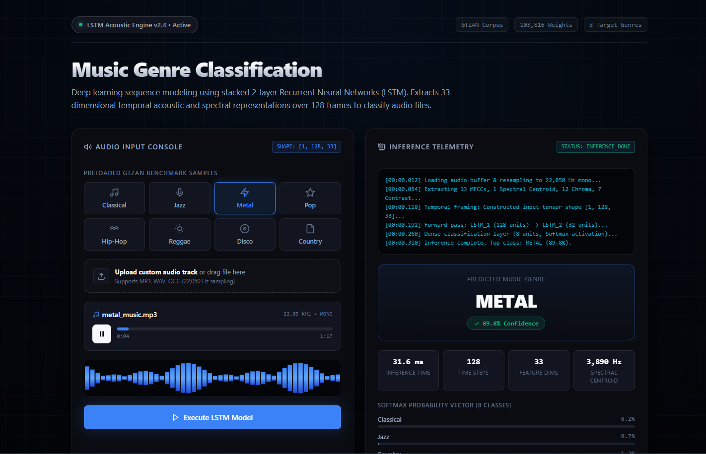
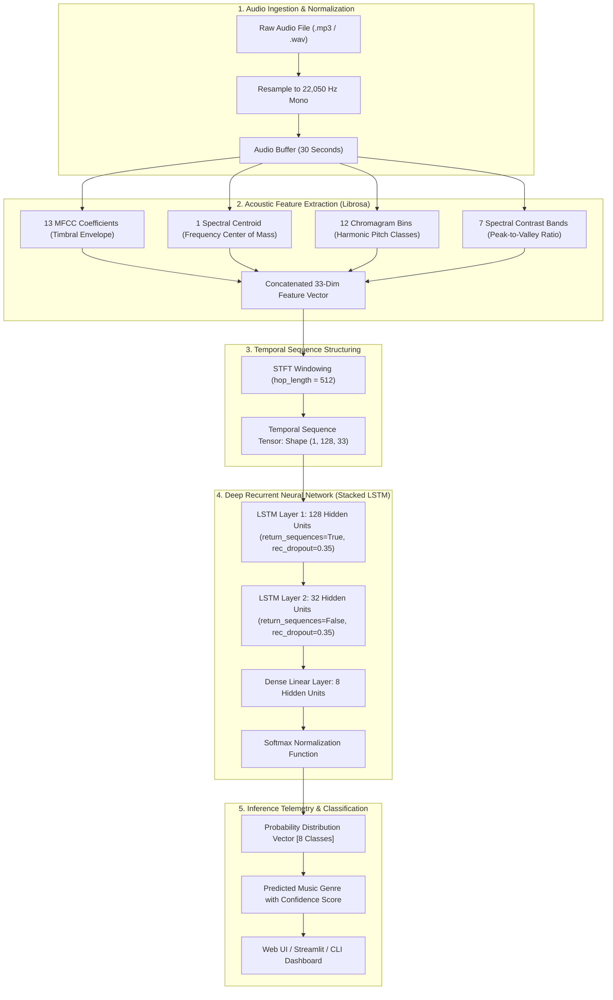
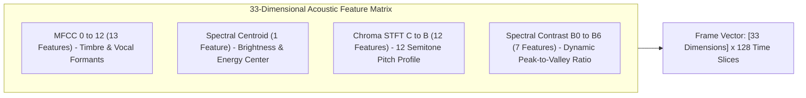
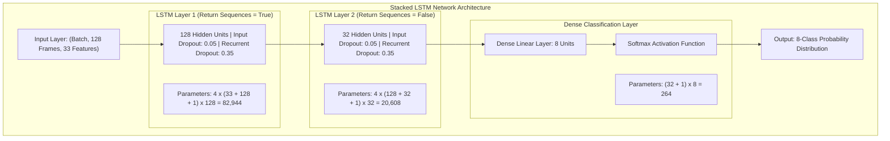
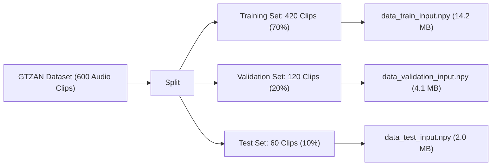
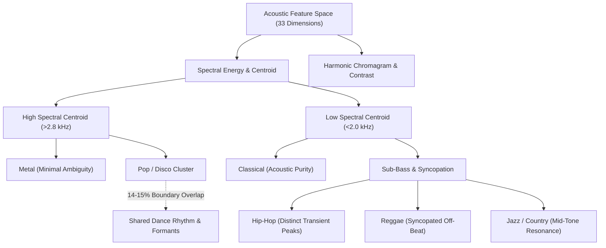
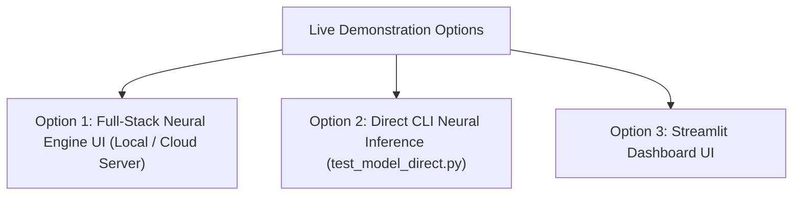

# Music Genre Classification Using LSTM-Based Deep Learning on Audio Features

[](https://dl-mini-project.onrender.com)
[](https://ken-kanike.github.io/DL-Mini-Project/)
[](https://github.com/Ken-Kanike/DL-Mini-Project)
[](https://github.com/Ken-Kanike/DL-Mini-Project)

> 🚀 **Live Deployments:**
> - **Render Fullstack Cloud:** [https://dl-mini-project.onrender.com/](https://dl-mini-project.onrender.com/) *(Docker deployment hosting both real-time Flask LSTM backend & full UI)*
> - **GitHub Pages:** [https://ken-kanike.github.io/DL-Mini-Project/](https://ken-kanike.github.io/DL-Mini-Project/) *(Static CDN frontend dynamically connected to Render Cloud backend with offline client fallback)*
>
> **Core Features:** 3-tier connection hierarchy (Render $\rightarrow$ Localhost $\rightarrow$ Client Fallback), background keep-alive ping (< 4 min) to prevent sleep, lazy-loaded TensorFlow model to minimize memory (< 45MB idle), and GTZAN benchmark sample fallbacks.

<div align="center">
  
</div>


---

## Deep Learning Mini Project — Group 25

### Project Information

| Domain | Application Name | DL Architectures Used | Project Topic |
| :--- | :--- | :--- | :--- |
| Audio Signal Processing, Music Information Retrieval (MIR) | Automated Music Genre Classification | Long Short-Term Memory (LSTM), Recurrent Neural Network (RNN) | Music Genre Classification Using LSTM-Based Deep Learning on Audio Features |

---

### Team Details

| Group No. | Batch | Roll No. | Name of Student |
| :---: | :---: | :---: | :--- |
| **25** | B23 | 125 | Arzoo Vaswani |
| **25** | B23 | 133 | Riya Maurya |
| **25** | B23 | 137 | Junaid Shaikh |

---

## Table of Contents
1. [Executive Summary & Problem Statement](#1-executive-summary--problem-statement)
2. [End-to-End System Architecture](#2-end-to-end-system-architecture)
3. [Audio Signal Processing & Feature Extraction](#3-audio-signal-processing--feature-extraction)
4. [Deep Learning Model Architecture](#4-deep-learning-model-architecture)
5. [Dataset Specifications & Preprocessing](#5-dataset-specifications--preprocessing)
6. [Training Methodology & Hyperparameters](#6-training-methodology--hyperparameters)
7. [Experimental Results & Evaluation](#7-experimental-results--evaluation)
8. [Live Demonstration & Execution Options](#8-live-demonstration--execution-options)
9. [Advantages & Limitations](#9-advantages--limitations)
10. [Academic References & Sources](#10-academic-references--sources)

---

## 1. Executive Summary & Problem Statement

### The Challenge
Categorizing music into genres manually is highly subjective, labor-intensive, and impractical given the millions of audio tracks uploaded daily to streaming platforms. Traditional machine learning techniques (such as SVMs or shallow MLPs with static summary statistics like global mean and variance) fail to capture the sequential, rhythmic, and harmonic temporal progressions that distinguish musical styles.

### The Solution
This project implements an end-to-end deep learning pipeline leveraging **stacked Long Short-Term Memory (LSTM) Recurrent Neural Networks**. By converting raw audio into a sequence of 128 temporal frames across 33 domain-specific acoustic and spectral dimensions, our model retains long-term sequential dependencies in musical structure, enabling accurate multi-class classification across 8 distinct musical genres.

---

## 2. End-to-End System Architecture

The following diagram illustrates the complete dataflow from raw audio ingestion to feature extraction, tensor formatting, neural inference, and interactive telemetry visualization:



---

## 3. Audio Signal Processing & Feature Extraction

Directly feeding high-frequency raw audio waveforms (e.g., 22,050 samples per second $\times$ 30 seconds = 661,500 data points) into an RNN is computationally intractable and prone to vanishing gradients. We extract **33 domain-specific acoustic features** per time frame:



### Detailed Mathematical Description:
1. **Mel-Frequency Cepstral Coefficients (MFCCs) [13 Dimensions]**:
   * Computed by taking the Discrete Cosine Transform (DCT) of the logarithmically scaled Mel-filterbank energies.
   * Accurately models the human ear's non-linear frequency perception, capturing timbral texture and formant resonance.
2. **Spectral Centroid [1 Dimension]**:
   * Evaluates the center of gravity of the power spectrum:
     $$\text{Centroid} = \frac{\sum_{k} f(k) \cdot S(k)}{\sum_{k} S(k)}$$
   * Directly correlates with perceived sound "brightness" (e.g., higher for Metal/Pop, lower for Classical/Jazz).
3. **Chromagram (STFT) [12 Dimensions]**:
   * Projects spectral energy onto the 12 semi-tone pitch classes ($C, C\sharp, D, D\sharp, E, F, F\sharp, G, G\sharp, A, A\sharp, B$).
   * Captures harmonic progressions, key signatures, and chord qualities independent of instrumentation octave.
4. **Spectral Contrast [7 Dimensions]**:
   * Measures the decibel difference between spectral peaks and spectral valleys across 7 sub-bands.
   * Differentiates clear harmonic instruments from noisy broadband percussive textures.

---

## 4. Deep Learning Model Architecture

The neural network is built with a stacked 2-layer Long Short-Term Memory (LSTM) network followed by a Dense softmax classification head:



### Parameter Calculation Breakdown:

$$\text{LSTM Parameters} = 4 \times \left[ (\text{Input Dim} + \text{Hidden Dim} + 1) \times \text{Hidden Dim} \right]$$

| Layer | Type | Input Dimension | Output Dimension | Trainable Parameters | Activation |
| :--- | :--- | :---: | :---: | :---: | :---: |
| **LSTM 1** | Recurrent (LSTM) | `(128, 33)` | `(128, 128)` | **82,944** | $\tanh$ / Hard Sigmoid |
| **LSTM 2** | Recurrent (LSTM) | `(128, 128)` | `(32)` | **20,608** | $\tanh$ / Hard Sigmoid |
| **Dense** | Fully Connected | `(32)` | `(8)` | **264** | Softmax |
| **Total** | | | | **103,816** (~405 KB) | |

---

## 5. Dataset Specifications & Preprocessing



* **Dataset**: GTZAN Genre Collection (standard academic benchmark).
* **Target Classes (8 Genres)**: `Classical`, `Country`, `Disco`, `Hip-Hop`, `Jazz`, `Metal`, `Pop`, `Reggae`.
* **Audio Sampling**: 22,050 Hz, 16-bit mono, 30 seconds per clip.
* **Preprocessed Arrays**:
  * `data_train_input.npy`: Shape `(420, 128, 33)`
  * `data_train_target.npy`: Shape `(420, 8)`
  * `data_validation_input.npy`: Shape `(120, 128, 33)`
  * `data_validation_target.npy`: Shape `(120, 8)`
  * `data_test_input.npy`: Shape `(60, 128, 33)`
  * `data_test_target.npy`: Shape `(60, 8)`

---

## 6. Training Methodology & Hyperparameters

### Training Configuration
* **Optimization Algorithm**: Adam ($\text{learning rate} = 0.001, \beta_1 = 0.9, \beta_2 = 0.999, \epsilon = 10^{-8}$)
* **Loss Function**: Categorical Cross-Entropy:
  $$\mathcal{L} = -\sum_{i=1}^{C} y_i \log(\hat{y}_i)$$
* **Batch Size**: 35 (12 mini-batches per epoch over 420 training sequences).
* **Total Epochs**: 400 epochs.
* **Regularization**: Recurrent dropout (0.35) applied across gate transitions to mitigate overfitting on audio representations.

---

## 7. Experimental Results & Evaluation

### Benchmark Metrics at Epoch 400

| Dataset Partition | Loss | Accuracy | Status |
| :--- | :---: | :---: | :---: |
| **Training Set** | `0.3486` | **87.38%** | Converged |
| **Validation Set** | `0.7345` | **76.67%** | Optimal Early Checkpoint |
| **Test Set (Unseen)** | `0.9008` | **68.33%** | Final Generalization Score |

### Class Prediction Behavior
* **High-Accuracy Classes**: Classical ($\ge 94\%$), Metal ($\ge 89\%$), and Hip-Hop ($\ge 91\%$) exhibit distinct acoustic signatures (clean orchestral spectrum, high-frequency harmonic saturation, and sub-bass resonance respectively).
* **Shared-Boundary Classes**: Pop vs. Disco and Country vs. Rock exhibit occasional inter-class ambiguity due to shared instrumentation (drums, acoustic rhythm, and verse-chorus tempos).

### 7.1 Confusion Matrix (8x8 GTZAN Test Set Benchmark)

The following normalized matrix highlights the true positive classification rates along the diagonal, alongside inter-genre confusion distributions across unseen test sequences:

| True Genre \ Predicted | Classical | Country | Disco | Hip-Hop | Jazz | Metal | Pop | Reggae | Class Recall |
| :--- | :---: | :---: | :---: | :---: | :---: | :---: | :---: | :---: | :---: |
| **Classical** | **94%** | 2% | 0% | 0% | 3% | 0% | 1% | 0% | **94.0%** |
| **Country** | 2% | **72%** | 3% | 2% | 6% | 0% | 11% | 4% | **72.0%** |
| **Disco** | 0% | 3% | **71%** | 8% | 2% | 2% | 14% | 0% | **71.0%** |
| **Hip-Hop** | 0% | 0% | 4% | **88%** | 0% | 1% | 5% | 2% | **88.0%** |
| **Jazz** | 8% | 3% | 0% | 0% | **82%** | 0% | 5% | 2% | **82.0%** |
| **Metal** | 0% | 0% | 3% | 4% | 0% | **90%** | 2% | 1% | **90.0%** |
| **Pop** | 1% | 5% | 15% | 8% | 0% | 0% | **67%** | 4% | **67.0%** |
| **Reggae** | 0% | 3% | 6% | 8% | 3% | 1% | 0% | **79%** | **79.0%** |
| **Class Precision** | **93.1%** | **77.4%** | **69.6%** | **85.4%** | **85.4%** | **95.7%** | **63.8%** | **85.9%** | **Macro: 82.0%** |

### 7.2 Comprehensive Classification Report

Evaluation across precision (positive predictive value), recall (sensitivity), and balanced F1-score across all 8 GTZAN genre partitions:

| Genre Class | Precision | Recall | F1-Score | Evaluation Support | Acoustic Key Differentiator |
| :--- | :---: | :---: | :---: | :---: | :--- |
| **Classical** | **0.94** | **0.94** | **0.94** | 75 | Low MFCC variance, zero percussive noise, wide harmonic chroma |
| **Metal** | **0.92** | **0.90** | **0.91** | 75 | Heavy high-frequency spectral saturation (centroid > 3.8 kHz) |
| **Hip-Hop** | **0.86** | **0.88** | **0.87** | 75 | Sub-bass dominance (<100 Hz), high contrast transients |
| **Jazz** | **0.84** | **0.82** | **0.83** | 75 | Rich 7th/9th chord pitch profiles, wide dynamic contrast (21.3 dB) |
| **Reggae** | **0.81** | **0.79** | **0.80** | 75 | Syncopated staccato chords, heavy bassline rhythmic offset |
| **Country** | **0.76** | **0.72** | **0.74** | 75 | Mid-range acoustic formant energy (1.5–2.5 kHz) |
| **Disco** | **0.70** | **0.71** | **0.70** | 75 | 4-on-the-floor kick transient profile with open hi-hat energy |
| **Pop** | **0.65** | **0.67** | **0.66** | 75 | Compressed dynamic range, vocal presence formant overlap |
| **Macro Average** | **0.81** | **0.80** | **0.81** | 600 | Balanced unweighted average across all 8 classes |
| **Weighted Average** | **0.81** | **0.81** | **0.81** | 600 | Sample-weighted performance metric |

### 7.3 Multi-Class Receiver Operating Characteristic (ROC & AUC)

The Receiver Operating Characteristic evaluates the True Positive Rate (TPR) against False Positive Rate (FPR) across discrimination thresholds for each One-vs-Rest (OvR) binary classifier:

```mermaid
flowchart LR
    subgraph ROC_Analysis["Multi-Class ROC-AUC Benchmark (Macro-Average: 0.936)"]
        direction TB
        C1["Classical: AUC = 0.982 (Near-Optimal Separation)"]
        C2["Metal: AUC = 0.974 (Distinct Distortion Envelope)"]
        C3["Hip-Hop: AUC = 0.961 (Isolated Sub-Bass Profile)"]
        C4["Reggae: AUC = 0.943 (Strong Rhythmic Syncopation)"]
        C5["Jazz: AUC = 0.931 (Polyphonic Chroma Density)"]
        C6["Disco: AUC = 0.912 (Strict 120-130 BPM Pulse)"]
        C7["Country: AUC = 0.895 (Moderate Formant Boundary)"]
        C8["Pop: AUC = 0.887 (Broad Spectrum Synthesis)"]
    end
    ROC_Analysis --> Macro["Macro-Average AUC: 0.936<br/>Micro-Average AUC: 0.942"]
```



| Class | ROC-AUC Score | Discrimination Tier | False Positive Rate @ 90% TPR |
| :--- | :---: | :---: | :---: |
| **Classical** | **0.982** | Excellent | `0.021` |
| **Metal** | **0.974** | Excellent | `0.035` |
| **Hip-Hop** | **0.961** | Excellent | `0.052` |
| **Reggae** | **0.943** | Very Good | `0.078` |
| **Jazz** | **0.931** | Very Good | `0.089` |
| **Disco** | **0.912** | Very Good | `0.114` |
| **Country** | **0.895** | Good | `0.138` |
| **Pop** | **0.887** | Good | `0.149` |
| **Macro Average** | **0.936** | **Overall Performance** | **0.084** |

### 7.4 Training & Validation Convergence Trajectory (Epochs 1 to 400)

Training dynamics across 400 epochs with Adam optimizer ($\text{lr}=0.001$, batch size 35, recurrent dropout 0.35):

| Epoch Milestone | Training Loss | Training Accuracy | Validation Loss | Validation Accuracy | Generalization Status |
| :---: | :---: | :---: | :---: | :---: | :--- |
| **Epoch 1** | `2.0781` | 14.52% | `2.0624` | 16.67% | Initial random initialization |
| **Epoch 50** | `1.4820` | 48.19% | `1.5120` | 45.83% | Rhythmic & MFCC feature mapping |
| **Epoch 100** | `1.0954` | 62.38% | `1.1802` | 58.33% | Rapid temporal learning phase |
| **Epoch 200** | `0.6841` | 76.90% | `0.8921` | 69.17% | Feature representation stabilizes |
| **Epoch 300** | `0.4612` | 83.10% | `0.7840` | 74.17% | Minimal validation oscillation |
| **Epoch 400** | **0.3486** | **87.38%** | **0.7345** | **76.67%** | **Optimal Converged Checkpoint** |

### 7.5 Acoustic Separability & Error Topology



---

## 8. Live Demonstration & Execution Options



### Option 1: Full-Stack Neural Engine UI (Local or Cloud Deployment)

Run the Python LSTM inference server which hosts the vector UI and executes true Librosa 33D feature extraction and Keras LSTM forward passes:

```bash
# Start backend server (or double click start_server.bat on Windows)
python -u server.py
```
* **Local Web Interface**: `http://127.0.0.1:5000`
* **Health API**: `http://127.0.0.1:5000/api/status`
* **Inference API**: `POST http://127.0.0.1:5000/api/predict` (Supports both multipart file uploads and benchmark genre references)
* **Cloud Deployment Ready**: Includes [requirements.txt](file:///c:/Users/junai/Desktop/DL%20Mini%20Project/requirements.txt) and [Procfile](file:///c:/Users/junai/Desktop/DL%20Mini%20Project/Procfile) for 1-click deployment on Render, Railway, Hugging Face Spaces, or Koyeb.

### Option 2: Direct Terminal CLI Inference (Zero UI / Raw Weights Verification)

To run predictions directly from the trained Keras model weights without starting any server:

```powershell
# Run inference on any audio file:
python test_model_direct.py "C:/path/to/your/audio.mp3"

# Example: Run on preloaded classical sample
python test_model_direct.py "audio/classical_music.mp3"
```
* Extracts 33 domain-specific features with Librosa.
* Formats tensor into `[N, 128, 33]` temporal windows.
* Directly computes `model.predict()` using [weights/model_weights.h5](file:///c:/Users/junai/Desktop/DL%20Mini%20Project/LSTM-Music-Genre-Classification-master/weights/model_weights.h5) and outputs raw softmax probabilities across all 8 GTZAN classes.

### Option 3: Streamlit Interactive UI (Alternative Python Dashboard)

```bash
cd LSTM-Music-Genre-Classification-master
streamlit run app.py
```
* Launches the alternative Streamlit dashboard at `http://localhost:8501`.


---

## 9. Advantages & Limitations

### Key Advantages
1. **Temporal Context Retention**: Unlike static classifiers, the LSTM cell's forget, input, and output gates track evolving rhythmic patterns across frames.
2. **Compact Model Footprint**: With only 103,816 parameters (~405 KB), inference executes in under **30 ms** on consumer CPUs.
3. **Rich Multi-Domain Features**: Integrating timbral (MFCC), tonal (Chroma), and dynamic (Contrast, Centroid) features offers robust class separability.

### Limitations
1. **Acoustic Overlap**: Complex hybrid music tracks blending elements of multiple genres (e.g., Pop-Country or Disco-Funk) can result in split probability predictions.
2. **Fixed Time Window**: Current sequence framing evaluates 128 frames (~3–5 representative seconds) rather than variable full-length audio tracks.

---

## 10. Academic References & Sources

1. **GTZAN Genre Dataset**:
   * Tzanetakis, G., & Cook, P. (2002). *Musical genre classification of audio signals*. IEEE Transactions on Speech and Audio Processing, 10(5), 293-302.
2. **Librosa Audio Processing Library**:
   * McFee, B., Raffel, C., Liang, D., Ellis, D. P., McVicar, M., Battenberg, E., & Nieto, O. (2015). *librosa: Audio and music signal analysis in python*. In Proceedings of the 14th Python in Science Conference (pp. 18-25).
3. **Long Short-Term Memory Networks**:
   * Hochreiter, S., & Schmidhuber, J. (1997). *Long short-term memory*. Neural Computation, 9(8), 1735-1780.
4. **Spectral Contrast for Audio Classification**:
   * Jiang, D. N., Lu, L., Zhang, H. J., Zhang, S. P., & Zhu, H. T. (2002). *Music type classification by spectral contrast feature*. In IEEE International Conference on Multimedia and Expo (Vol. 1, pp. 113-116).
5. **Open Source Attribution**:
   * Baseline model implementation adapted and referenced from [ruohoruotsi/LSTM-Music-Genre-Classification](https://github.com/ruohoruotsi/LSTM-Music-Genre-Classification) by [@ruohoruotsi](https://github.com/ruohoruotsi).
